# Cozy Reads

A free, private reading journal: free-form journal pages with stickers and handwriting, a TBR, a bookshelf, trackers, challenges and more, synced to your account.

**Live:** [cozy-reads-dun.vercel.app](https://cozy-reads-dun.vercel.app)

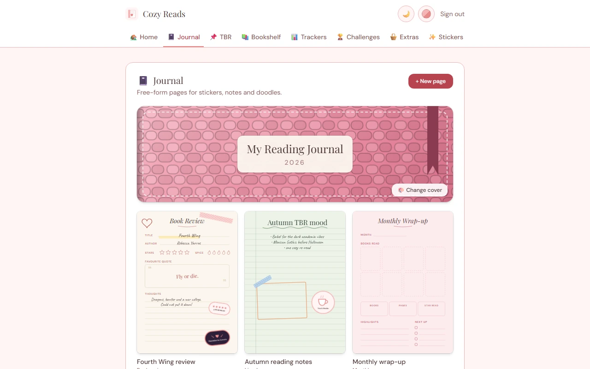

## Features

### Home

Yearly goal and progress, what you are reading now, and quick stats.

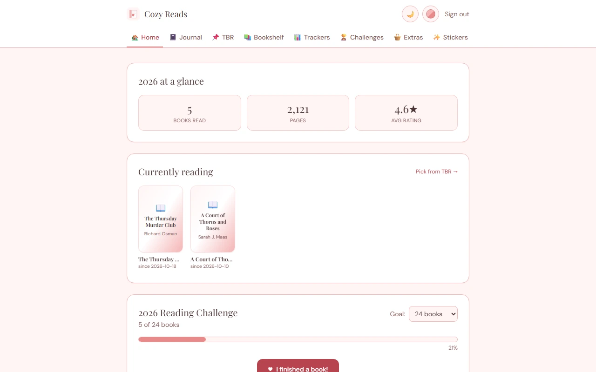

### Journal

Free-form pages on a notebook with a choice of 10 covers.

- 7 page templates and a paper colour picker, including a honeycomb colour picker.
- Drag-and-drop stickers (115 in the library), washi tape, text boxes and photo upload.
- Handwriting with fountain, ballpoint, brush and pencil pens, pressure sensitivity, palm rejection, zoom, lasso selection and two erasers. Hold a stroke to snap it to a shape.
- 22 shapes and page elements: checklist, star, spice and mood rows, table and quote.
- Export a page as a PNG.

<table>
  <tr>
    <td width="50%">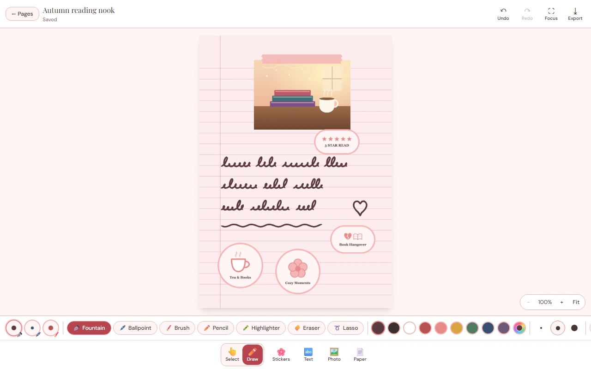</td>
    <td width="50%">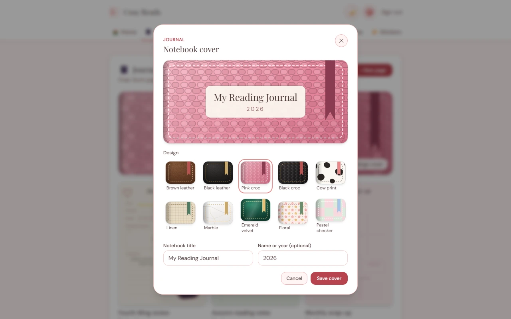</td>
  </tr>
</table>

### TBR

A to-be-read list, seasonal TBRs, monthly picks, a wishlist and a TBR Jar that picks your next book for you.

### Bookshelf

Browse by cover or as a row of spines, with custom spine colours and patterns. Reviews come in a full and a mini form: stars, spice, mood, tropes, quotes and DNF.

<table>
  <tr>
    <td width="50%">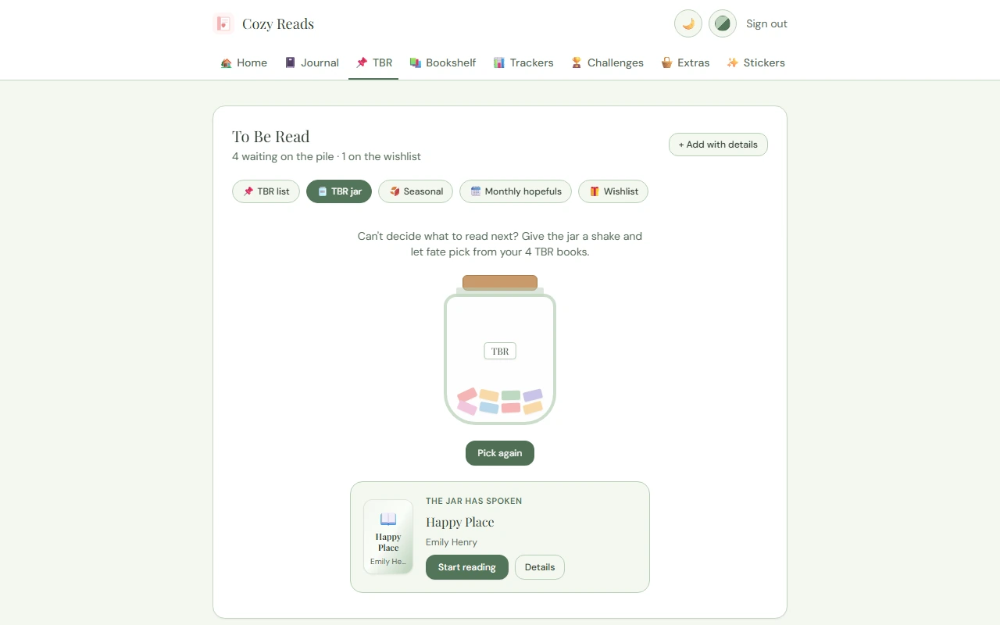</td>
    <td width="50%">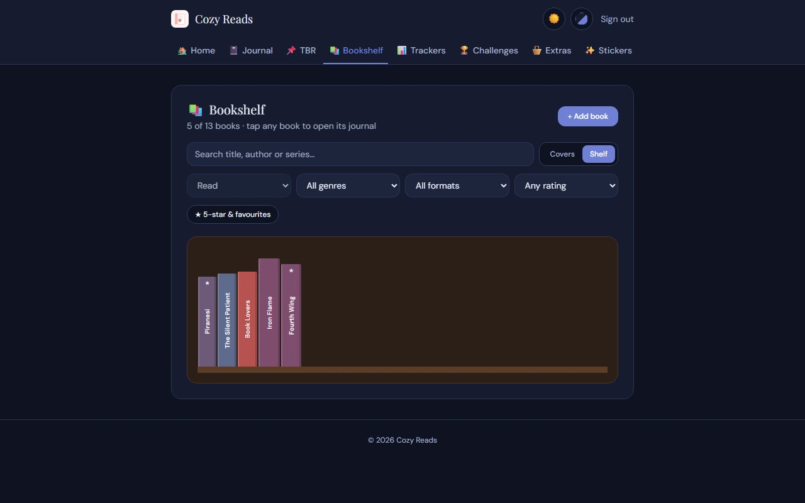</td>
  </tr>
  <tr>
    <td colspan="2">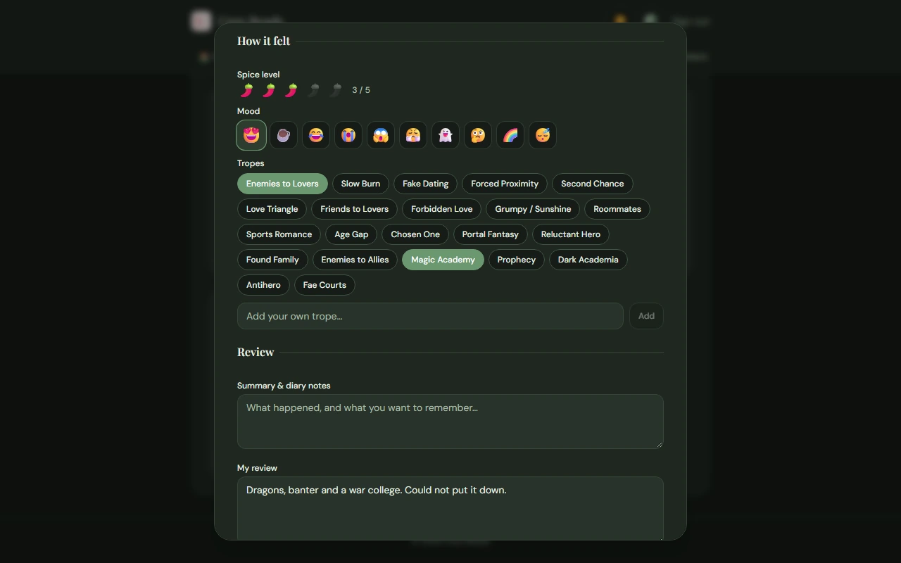</td>
  </tr>
</table>

### Trackers

Nine trackers: books read, a daily reading log with streaks and a calendar heatmap, series, DNF, ARCs, favourite authors, quotes, habits and haul.

### Challenges

Bingo boards, an A to Z challenge, 25 / 50 / 100 number challenges, a book battle bracket and custom challenges.

<table>
  <tr>
    <td width="50%">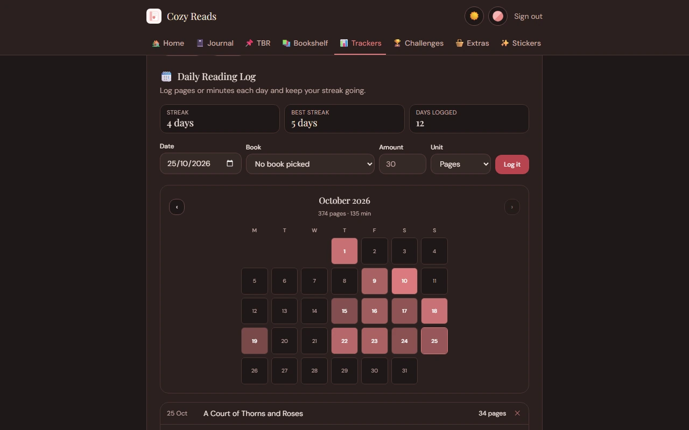</td>
    <td width="50%">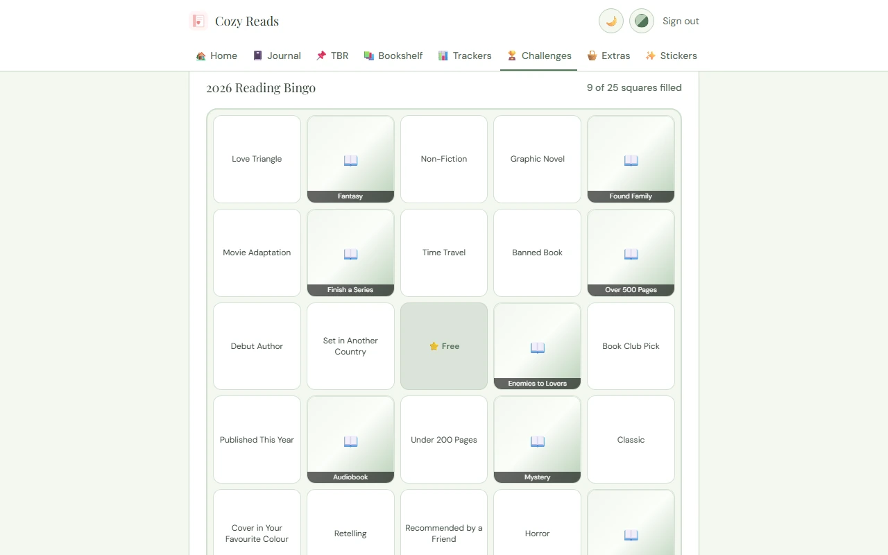</td>
  </tr>
</table>

### Extras

Monthly view, year in review, book club, budget, events, content planner and mood boards.

### Stickers

A vault of 115 stickers you can copy or save, grouped by ratings, spice, genres, tropes, moods, frames, washi and more.

<table>
  <tr>
    <td width="50%">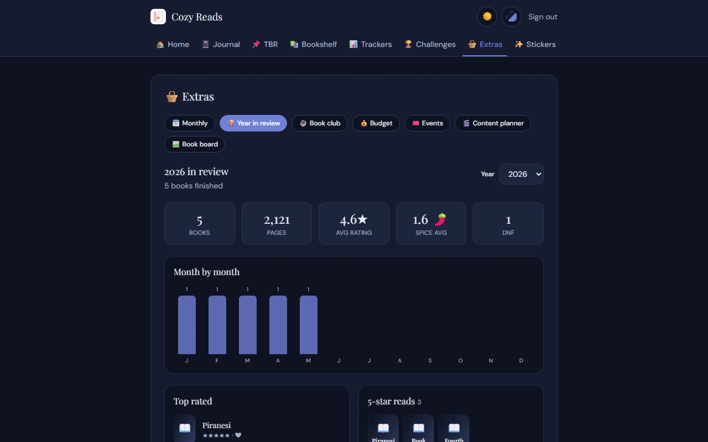</td>
    <td width="50%">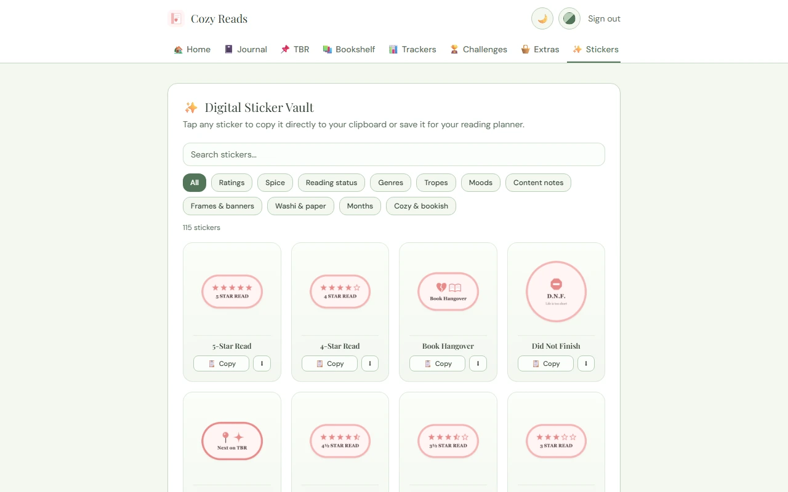</td>
  </tr>
</table>

### Everywhere

- 7 colour palettes (5 light and dark, 2 dark-only), with a light/dark toggle.
- Installs as an app (PWA) and works on phones.
- Private by default: every row is scoped to your account.

<table>
  <tr>
    <td width="33%">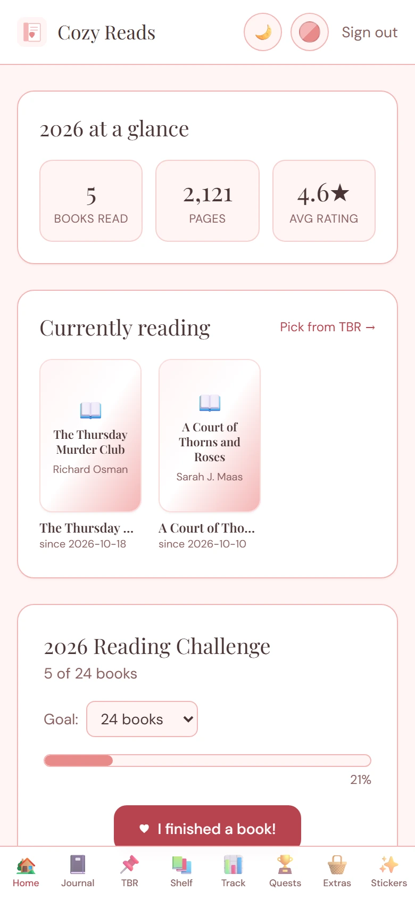</td>
    <td width="33%">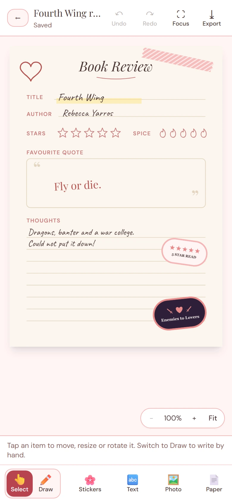</td>
    <td width="33%">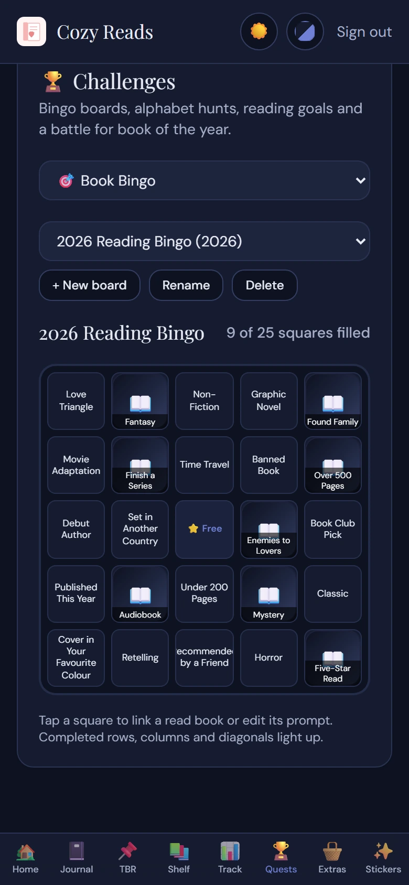</td>
  </tr>
</table>

On small screens the tab bar sits at the bottom and uses shorter labels (Track, Quests).

## Install as an app

Open the live site in a browser, then:

- **iOS (Safari):** tap Share, then **Add to Home Screen**.
- **Android (Chrome):** open the menu and choose **Install app** (or **Add to Home screen**).
- **Desktop (Chrome or Edge):** click the install icon in the address bar, or open the menu and choose **Install Cozy Reads**.

## Tech stack

| Layer | Tool |
|---|---|
| UI | React 19, Vite |
| Styling | Tailwind CSS 3 |
| Handwriting | perfect-freehand |
| Auth, database, storage | Supabase (PostgreSQL, Auth, Storage) |
| Hosting | Vercel |
| Lint | oxlint |

## Architecture

**Data.** Books live in `user_books` and yearly goals in `reading_goals`. Everything else is stored in one generic table, `journal_entries`, with columns `user_id`, `kind`, `entry_date` and a `data` JSONB payload. `kind` is namespaced by feature:

| Prefix | Kinds |
|---|---|
| `journal.` | `page`, `settings` |
| `trackers.` | `reading_log`, `series`, `favorite_authors`, `haul` |
| `challenges.` | `bingo`, `az`, `count`, `bracket`, `custom` |
| `extras.` | `monthly_note`, `year_review`, `book_club`, `budget`, `savings`, `purchase`, `subscription`, `event`, `content`, `board`, `settings` |

**Row-level security.** RLS is enabled on every table, with select, insert, update and delete policies that require `auth.uid() = user_id`. Only the anon key is used in the browser; the service role key is never needed.

**Private storage and signed URLs.** The `covers` bucket (book covers and journal photos) is private and each user can only read, write or delete files under their own `<user id>/` folder. Rows store a `covers:<path>` reference, and the app turns it into a short-lived signed URL when it is shown. Downloads from the `reading-assets` bucket use 60-second signed URLs.

**Service worker.** `public/sw.js` precaches a small app shell, serves built assets cache-first and navigations network-first with an offline fallback. It only handles same-origin requests (plus Google Fonts), so requests to Supabase are never cached and user data and signed URLs always come from the network.

**Demo mode.** In development, `/?demo=1` loads the app with in-memory sample data and no Supabase connection. It is compiled out of production builds.

## Local setup

```bash
git clone https://github.com/fazal305/cozy-reads.git
cd cozy-reads
npm install
cp .env.example .env
```

1. Create a free project at [supabase.com](https://supabase.com).
2. In the SQL editor, run [`supabase/setup.sql`](supabase/setup.sql). It is safe to re-run.
3. Optional, for the downloadable planner and sticker packs on Home: create a private Storage bucket named `reading-assets`, upload the files listed in [`src/components/AssetDownloads.jsx`](src/components/AssetDownloads.jsx), and add a SELECT policy for authenticated users.
4. Fill in `.env` from Supabase, Settings, API:

   | Variable | Description |
   |---|---|
   | `VITE_SUPABASE_URL` | Supabase project URL |
   | `VITE_SUPABASE_ANON_KEY` | Public anon key, protected by RLS |

5. Start the dev server:

   ```bash
   npm run dev
   ```

To explore without a Supabase project, open `http://localhost:5173/?demo=1` (dev server only).

## Scripts

| Script | What it does |
|---|---|
| `npm run dev` | Start the Vite dev server |
| `npm run build` | Production build into `dist/` |
| `npm run preview` | Serve the production build locally |
| `npm run lint` | Run oxlint |

Pushing to `main` deploys to Vercel.

## License

Cozy Reads is licensed under the [PolyForm Noncommercial License 1.0.0](LICENSE). You can use, modify and share it for non-commercial purposes. Commercial use requires a paid license: see [COMMERCIAL-LICENSE.md](COMMERCIAL-LICENSE.md) or contact [fazalabbas2002@gmail.com](mailto:fazalabbas2002@gmail.com). Versions up to the `last-mit` tag were released under the MIT license. Third-party licenses are listed in [THIRD_PARTY_NOTICES.md](THIRD_PARTY_NOTICES.md).
